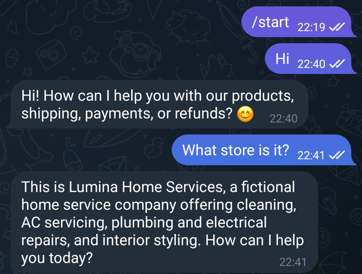
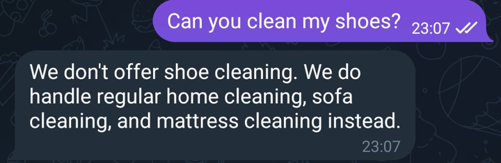
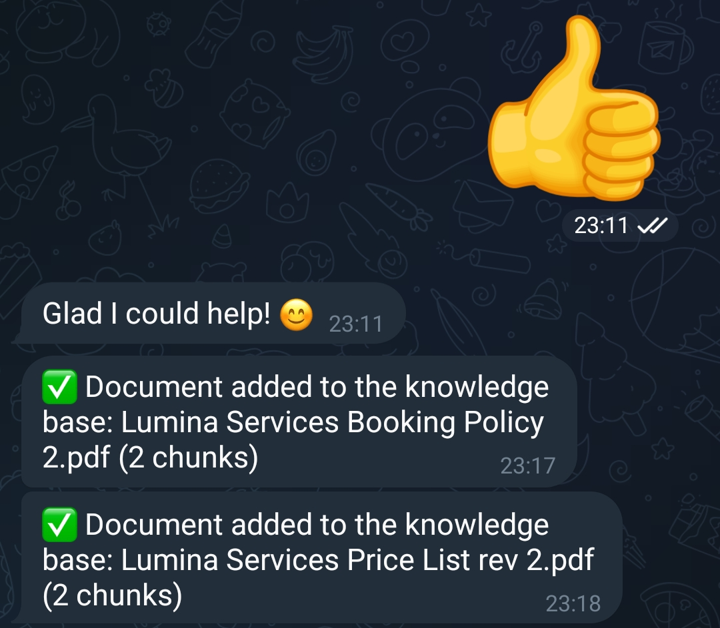
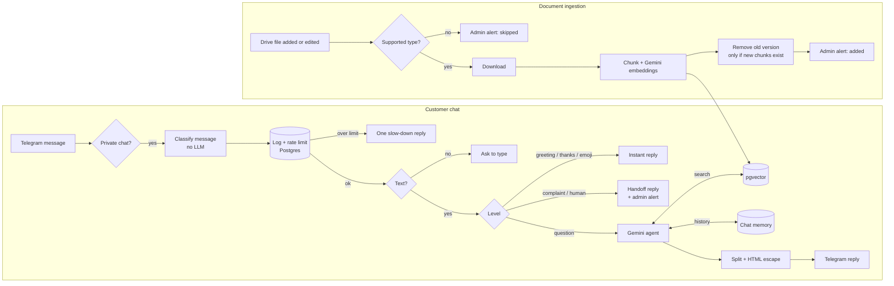

# Telegram RAG Support Bot (n8n)

A Telegram customer support bot that answers questions **only from your own documents** in a Google Drive folder. Built with n8n, Google Gemini and Postgres pgvector (Supabase).

When the answer is in your documents, the bot replies like a real support agent: short, friendly and in the customer's language. When it isn't, the bot says so instead of guessing, and offers to connect the customer with a human.

**Live demo:** [t.me/luminastore635_bot](https://t.me/luminastore635_bot) — a fictional home services company called *Lumina*. Try asking about AC cleaning prices, cancellation rules or service areas.

   

---

## Screenshots

| Answers from the documents | Suggests alternatives instead of guessing | Admin alerts |
|---|---|---|
|  |  |  |

---

## What it does

- Answers only from files in a Google Drive folder (PDF, Google Docs, Word, TXT, CSV)
- Replies in a human tone, in the customer's language, with no robotic phrases
- Suggests the closest alternative when a customer asks for something that isn't offered
- Hands the conversation to a human on request or on complaints, and alerts the admin on Telegram
- Handles greetings, thanks and emoji instantly without calling the AI
- Limits each chat to 10 messages per minute, with a single slow-down reply
- Answers private chats only, so it stays quiet if added to a group
- Re-indexes a document automatically when it is edited in Drive
- Reports every ingestion result, AI failure and workflow error to the admin

---

## How it works



---

## Engineering decisions

**Routing without an LLM.** A Code node classifies each message with keyword rules before anything reaches the AI. Greetings, thanks and emoji get an instant reply, and complaints go straight to a human. This cuts cost and latency, and keeps the AI focused on real questions.

**Atomic rate limiting.** One SQL statement logs the message and counts the chat's messages in the last minute. The bot replies "slow down" only on the 11th message, then stays silent until the minute passes, so a spammer can't make the bot spam back.

**Safe document replacement.** When a file is edited, the new chunks are stored first, tagged with the execution ID. The old chunks are deleted only if the new ones exist. A broken, empty or scanned PDF never wipes the previous version.

**Grounded answers with a human tone.** The system prompt separates *how to talk* (short replies, the customer's language, banned robotic phrases) from *facts* (search before answering, never invent numbers, never mention "documents"). Unlisted products get the closest real alternative, and missing information points to the human handoff.

**Telegram-safe output.** All messages use HTML parse mode, and every dynamic value (file names, customer text, AI answers) is escaped. An underscore in a file name or a stray asterisk in an answer can't break delivery. Long answers are split below Telegram's 4096-character limit.

**Nothing fails silently.** File type checks, retries on downloads and embeddings, and an error workflow mean every failure ends as a clear Telegram alert to the admin, including trigger errors such as a Drive polling timeout.

---

## Tech stack

| Part | Tool |
|---|---|
| Orchestration | n8n (self-hosted) |
| Chat model | Google Gemini 3.5 Flash-Lite |
| Embeddings | Google `gemini-embedding-001` |
| Vector store and chat memory | Postgres + pgvector (Supabase) |
| Knowledge source | Google Drive |
| Channel | Telegram Bot API |

---

## Repository structure

```
.
├── workflow/
│   └── telegram-rag-support-bot.json   # Import this into n8n
├── sql/
│   ├── setup.sql                       # Tables and indexes (run once)
│   └── maintenance.sql                 # Remove a deleted document, daily log cleanup
├── sample-docs/                        # Fictional Lumina documents for testing
├── docs/
│   ├── test-scenarios.md               # Test messages and expected answers
│   └── screenshots/
└── LICENSE
```

---

## Setup (about 15 minutes)

1. **Database:** run [`sql/setup.sql`](sql/setup.sql) once in the Supabase SQL editor (or any Postgres with pgvector).
2. **Import:** in n8n, import [`workflow/telegram-rag-support-bot.json`](workflow/telegram-rag-support-bot.json).
3. **Credentials:**
   - **Postgres:** use the Supabase *Session pooler* connection with SSL = Require. Select it in all 5 Postgres / pgvector nodes.
   - **Telegram:** create a bot with [@BotFather](https://t.me/BotFather). Send `/start` to the bot from your admin account, otherwise admin alerts can't be delivered.
   - **Google Drive:** OAuth2 credential on *Detect New or Updated File* and *Download File from Drive*.
   - **Google Gemini:** one API key from Google AI Studio for the chat model and both embedding nodes.
4. **Placeholders:** replace `YOUR_ADMIN_CHAT_ID` in the 6 *Notify Admin* nodes and `YOUR_DRIVE_FOLDER_URL` in the Drive trigger.
5. **Settings:** set your timezone and select this workflow as its own *Error workflow*, then publish.
6. **Documents:** add files to the Drive folder after publishing. Files that were already there are picked up once they are edited or renamed.

The same steps are written in the sticky notes inside the workflow.

---

## Testing

[`docs/test-scenarios.md`](docs/test-scenarios.md) lists messages to send to the bot, with the answer expected from the sample documents. It covers routing, document answers, trick questions, memory, rate limiting and document updates.

---

## Known limitations

- **Opening hours:** Gemini Flash-Lite sometimes says "we're open" outside opening hours. A stronger model, or computing open/closed in a Code node before the AI, fixes this.
- **Subfolders** of the Drive folder are not watched.
- **Deleted files** keep their chunks until removed with the query in [`sql/maintenance.sql`](sql/maintenance.sql).
- **Scale:** without a vector index, search is fast for a few thousand chunks, which covers most small business knowledge bases.
- **Language:** the instant replies and keyword rules are in English. Other languages fall through to the AI, which replies in the customer's language.

---

## Customization

- Keyword rules and instant replies: *Classify Message Level* node
- Tone, rules and brand voice: *AI Support Agent* system prompt
- Rate limit: *If Message Count Exceeds Limit* and *Check Message Over Limit*
- Another model: swap *Generate Chat Responses* for OpenAI, Anthropic or OpenRouter

---

## Author

Built by **Eko Sarwono** as part of an AI automation portfolio.

Licensed under the [MIT License](LICENSE).
